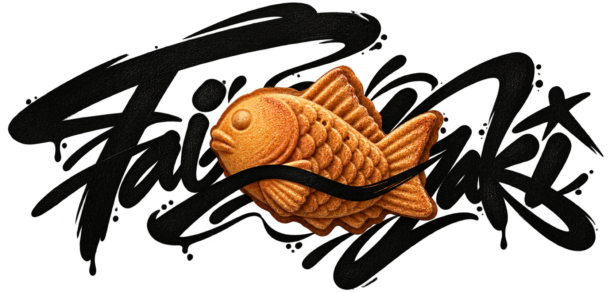

<div id="top"></div>

<div align="center">

<picture>
  <source media="(prefers-color-scheme: dark)" srcset="./assets/dark-full-logo.png">
  <source media="(prefers-color-scheme: light)" srcset="./assets/full-logo.png">
  
</picture>

**Gated planning state for long-horizon agents.**

[Website](https://fabioflorey.github.io/taiyaki/) ·
[Documentation](./docs/INDEX.md) ·
[Repository structure](./docs/architecture/ARCHITECTURE.md)

</div>

## Project status

Taiyaki is an early-stage project. Its current tracked source does not ship
a runnable Rust server, MCP implementation, or verification engine.

The website illustrates the product concept rather than presenting a working
quickstart. The repository currently contains the static site, its assets,
documentation, and workflow configuration.

## Website source

The static website is prepared under `site/` with separate directories for
CSS, JavaScript, images, and fonts. The existing website files under `docs/`
remain temporarily for compatibility with the previous GitHub Pages layout.
The publication source has **not** been switched automatically.

Validate the new static site locally:

```sh
bash scripts/check-site.sh
```

This validates static assets; it does not deploy the website or test a Rust
server. See [repository architecture](./docs/architecture/ARCHITECTURE.md)
for the actual source layout.
