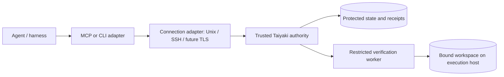

<div id="top"></div>

# Architecture (MVP RFC)

## Table of Contents

- [Current implementation boundary](#current-implementation-boundary-verified-2026-10-12)
- [Product boundary and threat model](#product-boundary-and-threat-model)
- [Proposed MVP decisions](#proposed-mvp-decisions)
- [Connection and runtime adapters](#connection-and-runtime-adapters)
- [States, transitions and tool surface](#states-transitions-and-tool-surface)
- [Working-tree digest contract](#working-tree-digest-contract-proposal-taiyaki-tree-v1)
- [Receipts and provenance](#receipts-and-provenance-proposed-data-contract)
- [Invariant acceptance tests](#invariant-acceptance-tests-required-before-claiming-an-mvp)
- [Scope and implementation sequencing](#scope--implementation-sequencing)

[Documentation index](../INDEX.md) | [Deployment and adapter reference](../reference/DEPLOYMENT.md)

**Audience:** Developers, maintainers, operators, and security reviewers planning Taiyaki's Rust core, connection adapters, and execution authority.

**Status: proposal, not an implemented contract.** These decisions require owner review before further Rust or MCP implementation. The document describes intended architecture, not capabilities currently shipped.

## Current implementation boundary (verified 2026-10-12)

At the time of this RFC, the tracked repository contains documentation,
assets and placeholder CI, but no tracked executable Rust core. A local, **untracked** Rust scaffold defines
`Project`, `Chapter`, `Task`, `Subtask`, `TestSet`, `Test`, and `TestRun`
data types with constructor tests. It is not a state machine and does not implement
I1–I4, MCP, receipts, filesystem hashing, or a server. The untracked scaffold is
not part of the public release.

The website currently depicts the *target architecture*. It must not be read as
evidence that this functionality is available in a released binary.

## Product boundary and threat model

Taiyaki is a **harness-independent completion authority**, not a replacement
for the coding harness. Agents may propose plans and progress; the trusted
server decides which requests are admissible and whether a task is complete.

For the MVP, an agent is an untrusted client with potential write access to
project files, but **without** write access to Taiyaki's state, approved gate
definitions, or verification runner policy. If an agent can run arbitrary
commands as the server's OS user (including via sudo), the trust boundary
collapses; same-user stdio alone is not a security boundary. **Verification
commands must also execute as a distinct, restricted worker principal**, not
as the authority process: test code and build scripts in an agent-editable
repository are themselves untrusted. The worker must not be able to rewrite
state, receipts, approved gates or the authority's socket policy.

The server can gate **its own API and MCP tools**, not third-party editors or
shell tools offered directly by another harness. External edits are therefore
detected through verification freshness checks rather than magically prevented.

## Proposed MVP decisions

| Topic | Proposed decision | Rationale / remaining trade-off |
|---|---|---|
| Execution authority | Local or remote Taiyaki process with its own OS identity, separate from agent and verifier worker | Defines who may validate state and issue PASS, independently of transport. |
| Connection adapter | Unix socket locally; SSH-forwarded Unix socket for remote host; authenticated remote HTTP API as a later option | Connection method is chosen explicitly; SSH is a tunnel, not a verification implementation. |
| Runtime placement | Host process or isolated container, independent of connection method | Docker/Podman placement must not be mistaken for proof of an identity or sandbox boundary. |
| Tree hash | Deterministic SHA-256 snapshot of the working tree (see below) | Covers uncommitted and nonignored untracked files. Needs careful path and race handling. |
| Receipt | Versioned JSON evidence generated and stored only by server | Auditable and transportable. Signature/export deferred until trust keys are designed. |
| Gate | Trusted, pre-approved command + arguments + environment policy; immutable per finalized plan revision | Agent-proposed gates cannot silently weaken verification. Shell text from an agent is never executed as a gate. |
| Tools | Phase-scoped discovery where supported **and unconditional server-side validation** | Client tool-list caches must not bypass I1. |
| State | Protected server-owned directory outside repository, 0700, with atomic persisted updates | Prevents agent rewriting a receipt or transition log under the stated OS threat model. |
| Recovery | Explicit replan, unblock and reopen requests with authorization and provenance | No unlogged backward transitions or silent acceptance of stale PASS evidence. |

These are **recommendations**, not a record of owner approval. In particular,
the execution identity, approved gate ownership, tree hashing rules, and
`done` invalidation policy are security-sensitive decisions.

## Connection and runtime adapters

Taiyaki should keep **three independent dimensions**:

1. **Client/protocol adapter:** MCP, CLI or a future API translates client
   requests into the same validated server commands. MCP never owns gate
   policy, state or PASS receipts.
2. **Connection adapter:** how a client reaches a Taiyaki authority
   (`local_unix`, `ssh_forwarded_unix`, and potentially authenticated
   `remote_tls`). These names are design labels, **not implemented Rust
   types or accepted configuration keys**.
3. **Runtime placement and workspace binding:** where that authority
   executes (`host` or `container`), which OS principal owns protected
   state, which restricted worker runs gates, and **which actual workspace**
   the worker hashes and verifies.

Consequently, `SSH` is a connection mechanism, `Docker` is a deployment
mechanism, and `MCP` is a client-facing protocol. A local client can reach
a container's Unix socket; an SSH tunnel can reach a remote host or remote
container. No mode should be inferred from a reachable address alone.



**Security rule:** placement labels describe *requested* topology, not
*verified* isolation. Record requested, observed and verified properties
separately; refuse security claims if evidence is missing. The authority
resolves actor identity after authenticating the connection, never from an
untrusted caller-supplied field. Unix socket permissions and peer credentials
can authenticate local clients; SSH identity, host-key validation and mapping
of remote principals require explicit policy. A tunnel can hide original
peer credentials, so do not equate the socket's peer UID with the remote agent.

For a container deployment, the container user, host UID/GID mapping, state
volume ownership, mounted project, socket access and ability to reach a
Docker/Podman engine socket are separate security concerns. Running an agent
and Taiyaki in the **same container with shared privileges/state** does not
satisfy the separate-authority assumption.

See [Deployment and adapter reference](../reference/DEPLOYMENT.md) for
topologies, Dev/End User trade-offs, identity and workspace rules, and the
planned test matrix. No SSH tunnel, container launcher or remote endpoint is
implemented by this RFC.

## States, transitions and tool surface

Represent `Phase = Operational(Planning | Implementing | Verifying) |
Terminal(Done | Blocked)` explicitly, rather than flattening the five labels
into an unqualified list. `Blocked` is terminal for normal task execution;
`plan.unblock` is a separate, authorized administrative recovery operation.

| Phase | Proposed externally visible tools |
|---|---|
| planning | `plan.get`, `plan.add_phase`, `plan.add_gate`, `plan.finalize` |
| implementing | `plan.get`, `edit.apply`, `verify.begin`, `plan.request_replan` |
| verifying | `plan.get`, `verify.run` |
| done | `plan.get` |
| blocked | `plan.get`, `plan.unblock` (authorized actor only) |

Transitions proposed for the MVP:

- `planning -> implementing`: finalized plan and **trusted approval of gate policy**.
- `implementing -> verifying`: explicit verification request.
- `verifying -> done`: required gates produced server-generated PASS receipts
  for the **same current tree hash** and plan revision.
- `verifying -> implementing`: failed gate; old PASS receipts cannot certify
  a newly changed tree. Failure may instead move to `blocked` under policy.
- `implementing -> planning`: authorized replan; revision increments and
  previous receipts remain historical, never reusable as current proof.
- Any operational state `-> blocked`: explicit policy failure or human hold.
- `blocked -> planning/implementing`: trusted `plan.unblock` with a logged
  reason and new plan revision when gate requirements change.
- `done -> implementing`: trusted administrative **reopen** only, invalidating
  current completion while preserving its historical receipt and log.
- If the on-disk tree differs from the tree certified by a `done` receipt,
  the server must **not report the task as currently done**. It should log a
  server-originated invalidation and expose `blocked` until explicit recovery.

The implementation must specify concurrency/compare-and-swap semantics for
each request; overlapping verification and edits must not race to `done`.

## Working-tree digest contract (proposal: `taiyaki-tree-v1`)

Hash the **current filesystem content**, not `git write-tree` over the index
alone: an agent may have unstaged or untracked source changes. Candidate file
paths are enumerated at the repository root with:

```sh
git ls-files --cached --others --exclude-standard -z
```

This includes tracked files even if ignored, plus nonignored untracked files.
Sort by raw, repository-relative path bytes. Reject paths outside the root,
missing files, symlinks, submodules, nonregular files, ambiguous path encodings
or traversal races; do not follow symlinks. Ignore `.git` and Git-ignored
generated files; version all relevant test inputs and config rather than
silently excluding them.

For each candidate, append a length-prefixed path, executable-mode bit, file
length, and SHA-256 of the *exact bytes* to a domain-separated
`taiyaki-tree-v1\0` stream. SHA-256 of the stream is the tree digest.
The exact field encoding, empty-tree vector and reference examples must be
frozen with test vectors **before implementation**; an ordinary path listing
alone is not a reproducible digest.

Example of the **input set**, not a claimed digest: if `src/lib.rs` is
tracked and `tests/gate.rs` is untracked but not ignored, *both* enter the
snapshot. If `target/debug/test` is Git-ignored, it does not. Changing either
included file changes the digest (subject to cryptographic collision resistance).

Acquire a snapshot before verification and recompute after the command
finishes. A gate cannot PASS if the digests differ, the file set changes, or
the runner cannot safely enumerate/read the tree. The final `done` transition
must recompute freshness; checking it only at verification start is insufficient.

## Receipts and provenance (proposed data contract)

A receipt is issued by the server after executing a pre-approved gate; it
must never be accepted as a caller-supplied PASS claim. Proposed JSON fields:

```json
{
  "schema_version": 1,
  "receipt_id": "<server-issued-id>",
  "project_id": "<stable-project-id>",
  "plan_revision": 1,
  "tree_hash": "<taiyaki-tree-v1:sha256:hex>",
  "gate_id": "<approved-gate-id>",
  "command": ["cargo", "test", "--locked"],
  "exit_code": 0,
  "stdout_hash": "<sha256:hex>",
  "stderr_hash": "<sha256:hex>",
  "started_at": "<UTC-RFC3339>",
  "finished_at": "<UTC-RFC3339>",
  "actor": "<server-resolved-identity>",
  "result": "PASS"
}
```

Store environment policy and runner identity as associated versioned metadata,
with execution timeout and signal status recorded. Exit 0 alone is not enough:
a receipt PASS requires unchanged tree digest, a trusted gate, successful
execution, and durable persistence before state transition.

Every accepted transition event records previous and next state, project/task,
plan revision, actor resolved at the server boundary, timestamp, reason and
relevant receipt references. Write events durably before acknowledging success.
Receipts and transitions must be append-only at the application boundary
and protected by OS access controls. Signatures, cross-host verification and
tamper-evident log chaining are future design work; a JSON field alone is
not a cryptographic proof.

## Invariant acceptance tests required before claiming an MVP

| Invariant | Required behavioral test |
|---|---|
| I1 | Out-of-phase MCP/API invocation is rejected even when the client supplies a cached tool name; no state mutation occurs. |
| I2 | `done` is refused without every required PASS receipt for the current digest and plan revision; a post-PASS edit invalidates current completion. |
| I3 | Client-provided receipt or command output cannot produce PASS; the trusted authority issues evidence only after a restricted worker executes a pre-approved gate. |
| I4 | Successful and recovery transitions persist actor, timestamp, old/new state and receipt provenance across restart. |

Additional adversarial tests: race between edit and verify, symlink/traversal
rejection, gate policy mutation after finalization, stale plan revision,
nonzero exit, verifier timeout, interrupted state write and reopened task.

For actual boundaries (unit/component/system/remote), proposed scenario IDs,
isolated runners, evidence capture, anti-duplication rules and CI sequencing,
see [Testing strategy and evidence](../development/TESTING.md). Its tests
are **planned**, not implemented or executed.

## Scope / implementation sequencing

1. **Core Rust:** define typed lifecycle, pure transition policy and failing
   invariant tests first; choose digest test vectors and protected persistence.
2. **Tool/MCP:** implement server-side authorization and runner. Tool discovery
   is convenience, never the access-control boundary.
3. **Go-to-market:** publish runnable quickstart and truthful capability matrix
   only after end-to-end integration tests. Until then, site copy is an
   architecture target and CI is a placeholder.

This RFC adds **no executable behavior**, does not approve the gate runner's
OS privileges and does not authorize deployment, new dependencies, or a release.

<div align="right"><sub><a href="#top">&uarr; Back to top</a></sub></div>
