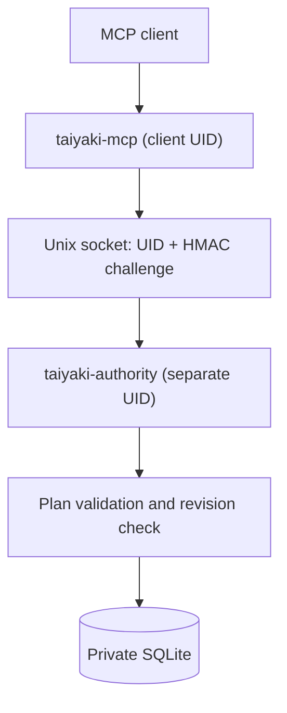

# Taiyaki architecture

Taiyaki currently implements a Rust planning model, a local stdio MCP
adapter, and a separate SQLite authority process accessed over a Unix socket.
The static concept website is independent of these components.

## Implemented authority path

[Planning model](../reference/PLANNING.md): versioned plans, work items,
dependencies, review submission, and optimistic revision checks.

[MCP and authority reference](../reference/MCP.md): four typed MCP tools,
local Unix-socket transport, Linux peer-credential check, per-connection
HMAC-SHA256 challenge-response, and transactional SQLite persistence.

The MCP adapter does not open SQLite; it forwards supported declarative
operations to the authority. SQLite data is stored in an authority-owned
private directory. An authenticated caller cannot choose arbitrary tools,
SQL commands, or filesystem paths through the MCP interface.

## Security boundaries

The authority and adapter **must** run under different Unix UIDs. The
authority authenticates the connecting process's UID and verifies a fresh
cryptographic challenge on every connection. The client identity is still
the Unix UID, not a uniquely attested executable: processes sharing that
UID can potentially access its key. A separate OS identity is necessary
for isolating unrelated MCP processes.

A plan marked `submitted` is ready for review, **not approved**.
Planning timestamps and owner labels are declarative, not authenticated
audit provenance. Gate IDs are references, not executable verification or
PASS receipts.

**Not implemented:** execution-phase enforcement (I1), source-bound
verification receipts (I2/I3), an isolated verification worker, durable
mandatory audit history (I4), multi-plan authority tenancy, or remote MCP
transport.

## Verification scope

The Rust tests exercise the planning model, SQLite transactions, and a real
stdio MCP-to-authority exchange. A Linux integration fixture starts an
authority under a distinct Unix UID and checks peer denial, invalid and
replayed HMAC proof, private database access, and plan persistence.

`bash scripts/check-site.sh` independently checks the website.
