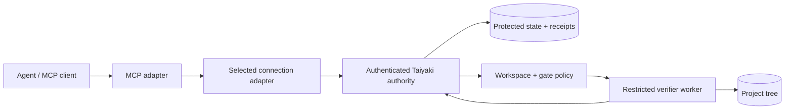

# Deployment and connection adapters (MVP proposal)

## Table of Contents

- [Scope and terminology](#scope-and-terminology)
- [Topologies](#topologies)
- [The adapter boundary](#the-adapter-boundary)
- [Identity, permissions and workspace](#identity-permissions-and-workspace)
- [Security status reporting](#security-status-reporting)
- [Trade-offs](#trade-offs)
- [Acceptance tests](#acceptance-tests)
- [Implementation status](#implementation-status)

[Documentation index](../INDEX.md) | [Architecture](../architecture/ARCHITECTURE.md)

**Audience:** Operators evaluating local, remote and container execution; maintainers designing Rust and MCP boundaries.

**Status: design proposal only.** No described connector, runtime, remote configuration, container launcher or verification service is shipped. Do not treat the names or examples below as working CLI/API values.

## Scope and terminology

The placement of **Taiyaki's completion authority** and the connection used
to reach it are distinct choices. An adapter can describe the chosen topology
and implement a connection, but it cannot simply assert that an endpoint is
secure or that it represents the desired filesystem.

| Dimension | Responsibility | Proposed examples |
| --- | --- | --- |
| Client adapter | Translate MCP/CLI messages into requests understood by the authority | MCP, CLI |
| Connection adapter | Connect/authenticate to a specific authority endpoint | Local Unix socket; Unix socket forwarded over SSH; future authenticated TLS |
| Runtime placement | Decide how the authority was deployed, independently of connection | Dedicated host process; rootless/restricted container |
| Verification worker | Run pre-approved gates on the bound workspace with fewer privileges than the authority | Separate restricted OS principal or isolated worker |
| Workspace binding | Identify the exact file tree and policy revision being verified | Explicit server-side project registration |

**MCP is not a security boundary** and does not choose a privileged local
execution path just because a caller claims to be local.

The proposed connection type labels (`local_unix`,
`ssh_forwarded_unix`, `remote_tls`) and placement labels
(`host`, `container`) are **illustrative design vocabulary**, not accepted
Taiyaki config keys or Rust enums.

## Topologies

| Case | Client-to-authority transport | Authority placement | Where gates and hashing run |
| --- | --- | --- | --- |
| Local Linux host | Unix socket with a restricted client group | Dedicated service OS identity | On that host, through a separate restricted worker |
| Another server over SSH | Unix-socket forwarding through operator-approved SSH tunnel | Dedicated service OS identity on the remote host | On the **remote** host, against its explicitly bound project tree |
| Taiyaki inside Docker/Podman | Unix socket shared through an intentionally mounted socket directory, or an explicitly authenticated endpoint | Dedicated restricted container, ideally rootless | In a separate restricted worker/container with explicitly mounted workspace |
| Container on remote server | SSH-forwarded Unix socket to the remote authority (or future authenticated TLS) | Remote container | On the remote runtime's explicitly bound tree |

A container is a **placement**, not a connection protocol. SSH is a
**transport**, not a mode that makes verification remote by itself.
A client running inside a container can use a local Unix socket if that is
the explicitly configured endpoint.

If an agent edits `host-A:/workspace` but a Taiyaki verifier hashes an
unrelated `host-B:/workspace`, a successful gate on B must **not** certify
A's task. Bind project identity to a canonical workspace on the authority
host, an approved gate policy revision and a snapshot digest; refuse
completion when that binding cannot be established.

No connection adapter automatically installs packages, creates containers,
starts services, opens SSH tunnels, edits firewall rules or copies source.
All these effects require an explicit setup workflow and operator approval.

## The adapter boundary

The proposed implementation should separate:

1. **Request routing:** MCP and CLI expose the same operations and errors.
   Every call is subject to I1 gating at the authority boundary, including
   calls to tools no longer listed for the current phase.
2. **Connection:** Resolve a named endpoint with explicit transport and
   credentials. Handshake records endpoint identity and server capabilities;
   do not infer deployment or filesystem identity from a hostname/port.
3. **Workspace execution:** The authority resolves a server-owned project
   binding and a constrained verifier worker. The worker can read necessary
   project inputs and use a dedicated output location without write access to
   state, receipts, approved gate policy or privileged sockets.
4. **Evidence:** Only the authority commits PASS receipts bound to gate,
   plan revision, the current workspace digest and execution provenance.
   Failed authentication, unknown workspace, insufficient permissions or
   unverifiable process separation must fail closed.

One authority may support more than one transport, but **all transports
must share the same authorization and phase gate**. Connection adapters
must not directly mutate persisted state or accept caller-issued receipts.

## Identity, permissions and workspace

**Local Unix socket:** Place the socket inside a controlled directory with
limited traversal permissions and give an explicit client group access to
the socket (for example, socket mode `0660`). Keep protected state in a
**different**, authority-owned `0700` directory. A client that can connect
is authenticated only to the degree actually checked by the server; group
membership alone does not authorize every transition.

**SSH:** Pin/verify remote host keys, authenticate the tunnelling principal
and explicitly map it to a Taiyaki actor/authorization policy. Unix
peer-credential checks on the remote forwarded socket may identify the
SSH forwarding process, **not the originating agent**. Forwarded traffic
needs a trusted, explicit identity binding; an open tunnel is not equivalent
to authorization for `plan.unblock` or admin reopen. A broken tunnel must
not produce a synthetic PASS or hide missing completion evidence.

**Container:** Check the effective host/container UID/GID mapping, volume
ownership, socket permissions and engine privilege mode separately.
Sharing the host's Docker/Podman engine socket or running a privileged
container can defeat isolation. The agent must not have write access to
Taiyaki's state volume or control over the authority process through engine
privileges. Putting agent and authority in the same container under the
same UID with a shared state mount is **not** a separate trust boundary.
A rootless engine is a useful isolation control, not an automatic security
attestation. Do not mount agent-writeable gate scripts as trusted policy.

**Verifier isolation:** Verification executes untrusted repository tests
and build scripts. Run these in a *separate*, least-privileged worker and
capture outputs in server-controlled storage. The trusted authority must
retain exclusive power to approve gates and issue receipts. Process UID,
mount permissions and effective isolation must be checked, not merely
requested in configuration.

**Freshness:** The server hashes the project tree visible to the verifier.
A tree change between checks or after PASS invalidates the current
completion claim (I2). The source host, verifier host and mount mapping
are part of the provenance that must remain consistent across runs.

## Security status reporting

Follow the distinction used in Jelly's deployment reference:

| Label | Meaning | Example |
| --- | --- | --- |
| **Requested** | Operator's selected configuration | A container is requested with a separate UID |
| **Observed** | Data measured from the running system | Process UID, mounted workspace, socket permissions |
| **Verified** | A security property backed by a specific passing check | The verifier cannot write the protected state directory |
| **Unverified** | A property not established by the available checks | A socket is reachable, but remote actor binding has not been validated |

Successful connectivity is not proof of authorization, workspace identity,
container isolation or a valid receipt. Diagnostics should state what was
tested, on which host, and which facts remain unverified.

## Trade-offs

| Option | Dev PRO | Dev CON | End User PRO | End User CON |
| --- | --- | --- | --- | --- |
| Local host + Unix socket | Small transport surface; easy to inspect OS ACLs | Requires separate users/groups and reliable socket lifecycle | Low network dependency; local verification | Local permissions setup |
| SSH-forwarded remote socket | Reuses operator-managed SSH credentials; keeps authority remote | Identity propagation, reconnect and host-key policy are complex | Works with an existing remote workspace | Requires SSH access and remote installation |
| Taiyaki in Docker/Podman | Repeatable runtime and explicit mounts | UID remapping, sockets, container security and verifier isolation are complex | Portable deployment choices | Engine/volume setup; rootless limitations |
| Future remote TLS endpoint | Can serve multiple remote clients | Authentication, replay protection, key lifecycle and exposure risk | Works without a persistent SSH tunnel | Certificates, server maintenance and networking |

**MVP recommendation:** implement the local Unix connection to a protected
authority and a separately restricted verifier first. Define the adapter
boundary now so that SSH forwarding does not change core transition logic.
Support container placement by validating mount/identity assumptions rather
than creating a separate gate engine. Add a directly exposed TLS endpoint
only after a threat review and authentication design.

## Acceptance tests

| Requirement | Test required before shipping |
| --- | --- |
| I1 | Out-of-phase operation is denied across every connection adapter; cached MCP tools cannot bypass the authority. |
| I2 | A PASS on an unrelated/old remote or mounted workspace cannot mark the client's task done; post-PASS edits invalidate current completion. |
| I3 | Untrusted client/worker cannot create a receipt, change approved gates, access authority state, or use caller-supplied command output as evidence. |
| I4 | Events preserve authenticated actor, endpoint/runtime identity, UTC timestamp, previous/next state and receipt references after restart. |
| Local ACL | Unapproved UID cannot reach socket; allowed client cannot write state directory. |
| SSH | Incorrect host key or unapproved principal is rejected; tunnel interruption does not grant success. |
| Container | Agent cannot mutate state volume or use an exposed engine socket to impersonate authority; mapped workspace is exactly the one verified. |
| Runtime isolation | An adversarial gate/build script running under the worker cannot edit the authority's receipt store. |

These are **planned tests, not executed results**. They require real,
isolated processes/hosts/containers, not only in-memory policy assertions.

## Implementation status

| Capability | Status as of 2026-10-12 |
| --- | --- |
| Architecture proposal | Documented here |
| Connection adapter abstraction | Not implemented |
| Unix-socket service | Not implemented |
| SSH forwarding integration | Not implemented |
| Docker/Podman packaging | Not implemented |
| Restricted verifier worker | Not implemented |
| Core phase gate, tree hashing, receipts, provenance | Not implemented |
| Executable cross-topology acceptance tests | Not implemented |

For the existing local untracked Rust scaffold and its actual scope, see
[Architecture](../architecture/ARCHITECTURE.md). Do not advertise these modes
as available until live integration checks pass.

<a href="#top">&uarr; Back to top</a>

